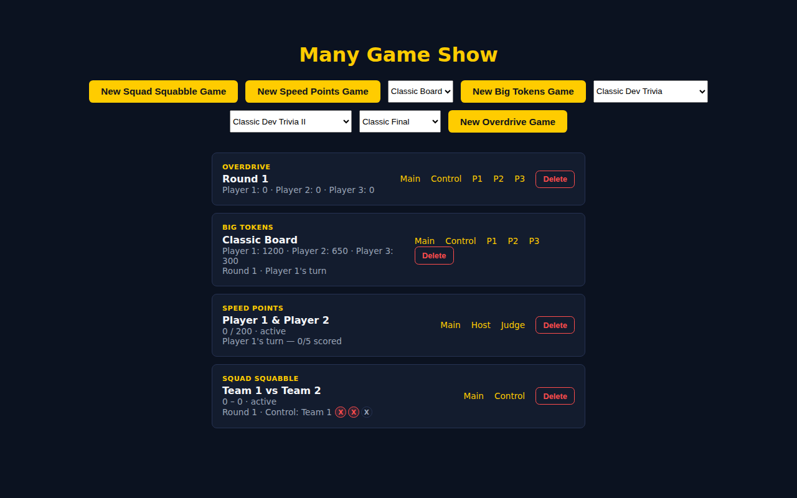
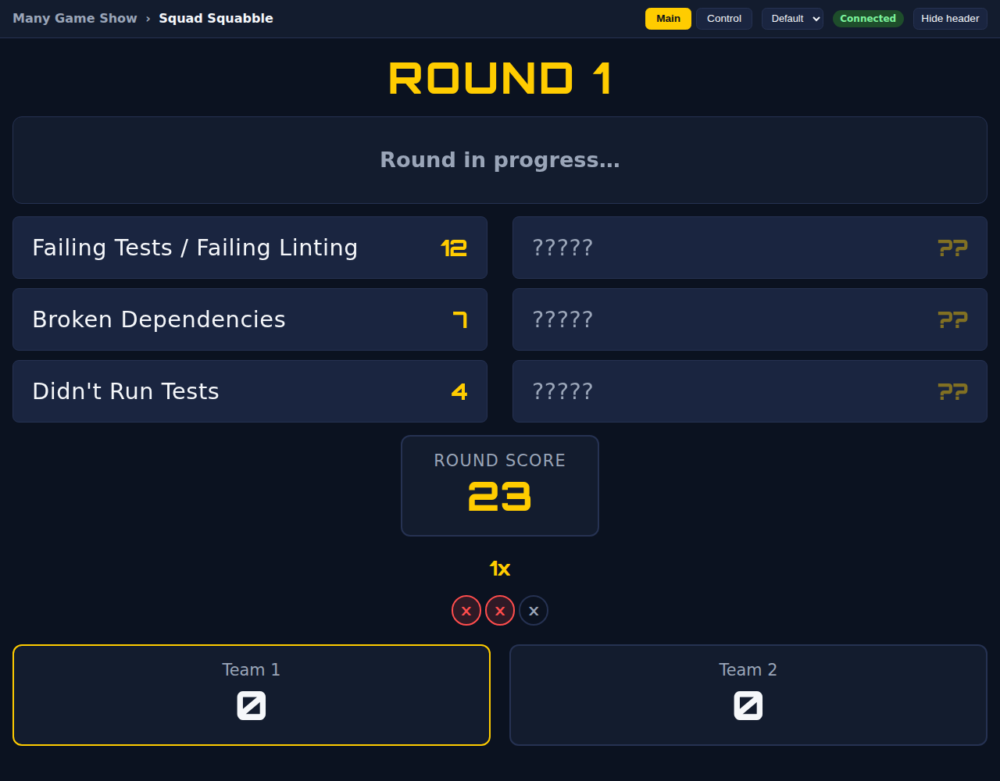
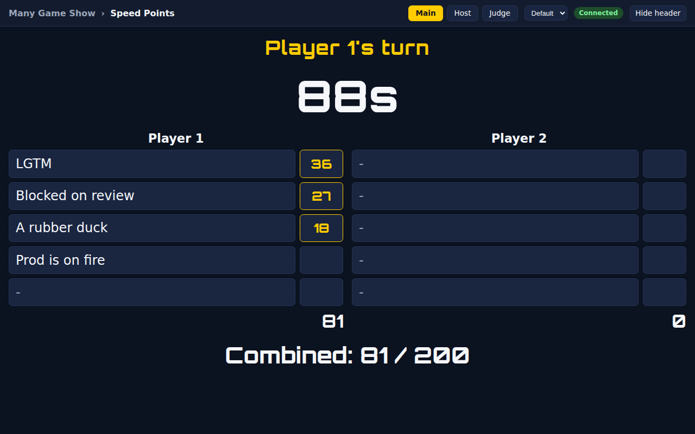
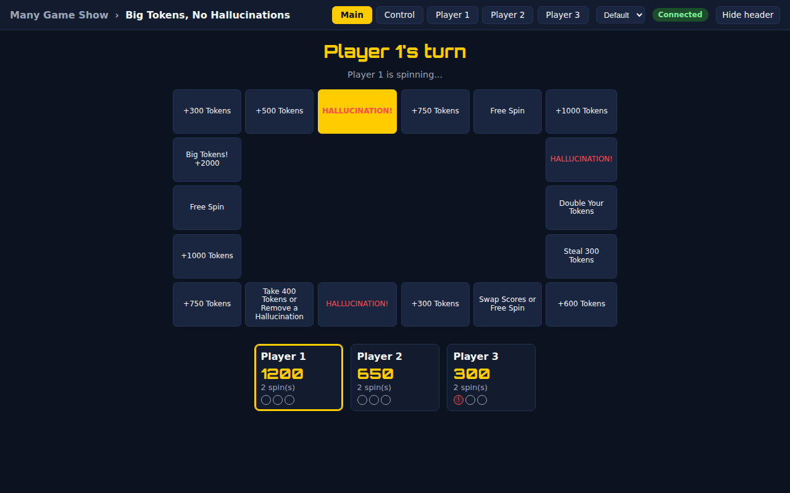
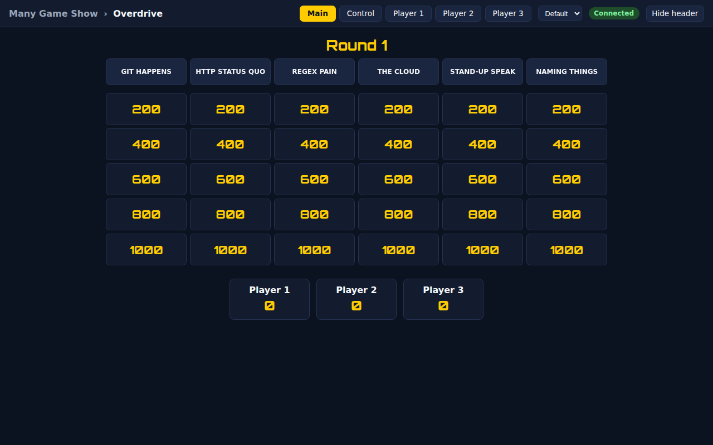
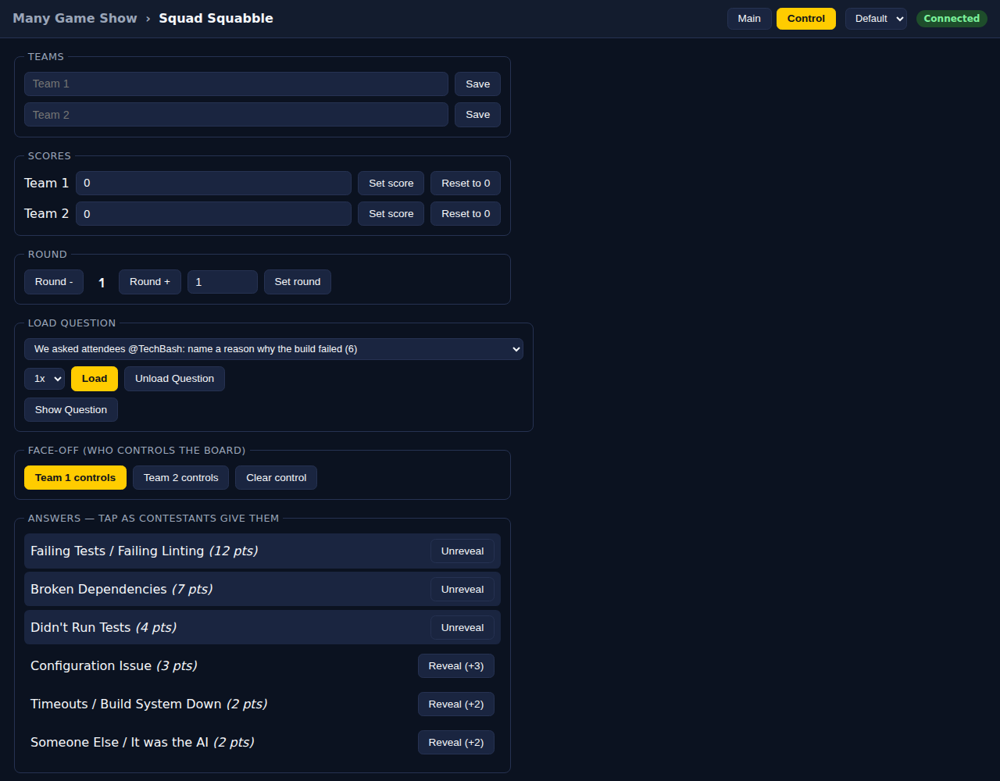
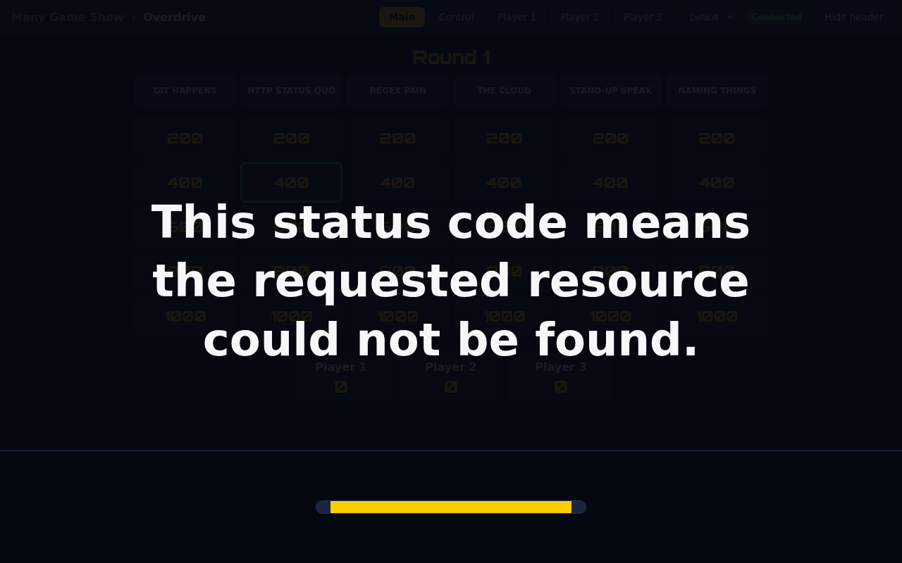
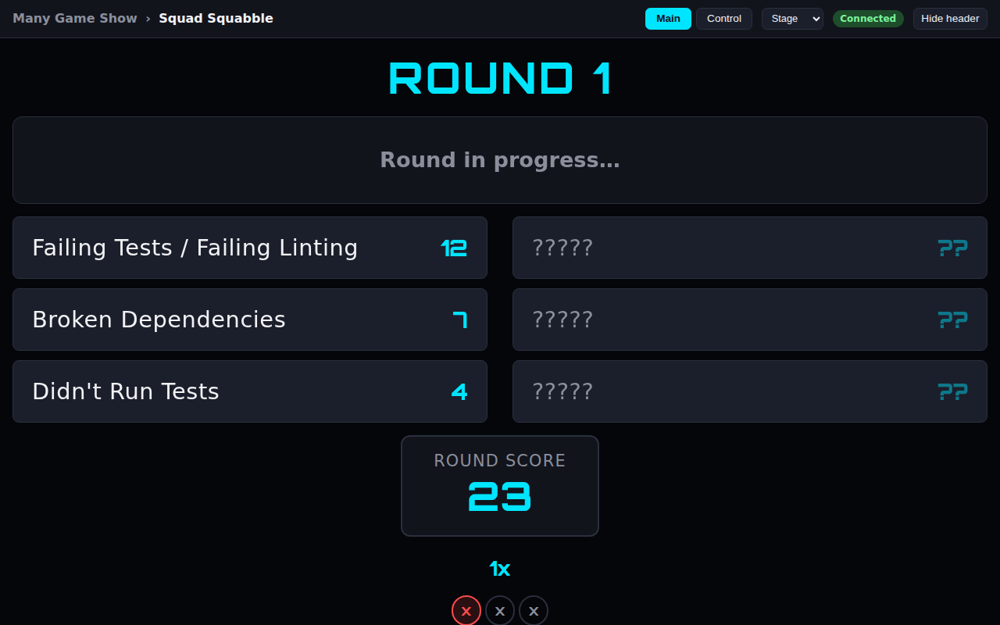

# Many Game Show

A small web app that runs live game shows — a lobby, a host's control
panel, and a big-screen "Main" view for the audience, with no accounts,
no build step, and no external services. FastAPI + SQLite on the backend,
vanilla HTML/CSS/JS on the front. It was built for a "50 minutes, idea to
working app" conference session, largely with an AI coding assistant (see
[AI attribution](#ai-attribution)).



## The games

Every game follows the same shape: the host runs it from a **Control**
view, the audience watches the **Main** view on a big screen, and where a
game has contestants they get their own **Player** views on phones or
laptops. State lives on the server and every screen polls it, so any
screen can be opened, closed or refreshed at any time.

| Game | What it is | Views |
|---|---|---|
| **Squad Squabble** | A Family-Feud-style survey game: two teams, a face-off for control, answers revealed against a survey board, strikes, and a round pot awarded to a team. | Main, Control |
| **Speed Points** | A Fast-Money-style relay: two players answer the same five questions against a countdown, a judge types and scores each answer, and a two-step reveal checks the combined score against a win threshold. | Main, Host, Judge |
| **Big Tokens** | A board game on a ring of 18 squares: a chase light runs around the board and each player stops it with their own button. Squares pay or steal tokens, hand out free spins, or give you a hallucination — collect too many and you're out. | Main, Control, Player 1–3 |
| **Overdrive** | A Jeopardy-style trivia game: reveal the categories, pick a clue, and the three players race to ring in from their own devices before the window closes. Includes a wager-before-you-see-it clue (Crit Boost), a second round and a Final Exam. | Main, Control, Player 1–3 |

| Squad Squabble | Speed Points |
|---|---|
|  |  |

| Big Tokens | Overdrive |
|---|---|
|  |  |

| Squad Squabble Control (host) | Overdrive clue on Main |
|---|---|
|  |  |

Every page has a theme picker; here is Squad Squabble in the high-contrast
**stage** theme meant for a projector:



---

## Running it

Requires [uv](https://docs.astral.sh/uv/) — everything else (Python 3.13
and all dependencies) lives in uv's auto-created `.venv`. On a new machine,
check first:

```bash
make preflight
```

This checks for `uv` and `git`, network reachability (PyPI is required),
a free port 8000, and whether Playwright's browser is installed (only
needed for `make test-ui`). It exits non-zero with fix instructions if
anything required is missing.

```bash
make sync   # install dependencies (uv sync --extra dev)
make run    # dev server with hot-reload (uvicorn manygameshow.main:app --reload)
```

Open **http://localhost:8000**, create a game from the lobby, and use the
links on each game's card to open its views — put **Main** on the big
screen, keep **Control** (or **Host** / **Judge**) for yourself, and send
the **P1/P2/P3** links to players.

The SQLite database (`manygameshow.db`) is created on first run.
**If you change a model's fields, run `make clean` (or delete the file)
before restarting** — there are no migrations (see
[ARCHITECTURE.md](./ARCHITECTURE.md)).

### Bringing your own content

Questions, boards and clue banks are data, not code, so you can swap in
your own without touching any source: point the matching environment
variable at a JSON file with the same shape as the bundled sample in
[`src/manygameshow/data/`](./src/manygameshow/data/). The full
walkthrough — file shapes, authoring tips and a check command per game —
is in [ADDING_CONTENT.md](./ADDING_CONTENT.md).

| Game | Environment variable(s) | Sample file(s) |
|---|---|---|
| Squad Squabble | `SQUAD_SQUABBLE_QUESTIONS_PATH` | `squad_squabble_questions.sample.json` |
| Speed Points | `SPEED_POINTS_QUESTIONS_PATH` | `speed_points_questions.sample.json` |
| Big Tokens | `BIG_TOKENS_BOARDS_PATH` | `big_tokens_boards.sample.json` |
| Overdrive | `OVERDRIVE_ROUND1_BANKS_PATH`, `OVERDRIVE_ROUND2_BANKS_PATH`, `OVERDRIVE_FINAL_BANKS_PATH` | `overdrive_round1.sample.json`, `overdrive_round2.sample.json`, `overdrive_final.sample.json` |

```bash
SQUAD_SQUABBLE_QUESTIONS_PATH=/path/to/my_questions.json make run
```

Speed Points always uses the first five questions in its file. Overdrive's
files hold several selectable banks per round; the lobby lists them in
dropdowns.

---

## Development

```bash
make lint         # ruff + djlint
make typecheck    # mypy
make test-backend # pytest (models + API)
make test-ui      # Playwright, real browser
make check        # all of the above
make screenshots  # regenerate docs/screenshots/ (see below)
```

CI runs the same checks on every push and PR — see
[`.github/workflows/ci.yml`](./.github/workflows/ci.yml).

Want to add a game? [ADDING_A_GAME.md](./ADDING_A_GAME.md) is a
step-by-step recipe, and [ARCHITECTURE.md](./ARCHITECTURE.md) explains the
conventions it relies on (server-authoritative timers, content as data,
one router/model/page per game).

### Regenerating the screenshots

`make screenshots` runs [`scripts/screenshots.py`](./scripts/screenshots.py),
which starts a throwaway server with its own temporary database (your dev
data is untouched), puts one game of each kind into a presentable state
through the API, and captures every view with Playwright into
`docs/screenshots/`. If Playwright can't find a browser, set
`PLAYWRIGHT_CHROMIUM_EXECUTABLE_PATH` as described in
[CLAUDE.md](./CLAUDE.md). Note that the Speed Points countdown and the Big
Tokens chase light are live, so those shots differ slightly each run.

---

## Project docs

- [ARCHITECTURE.md](./ARCHITECTURE.md) — stack, conventions, extension pattern
- [ADDING_CONTENT.md](./ADDING_CONTENT.md) — writing your own questions, boards and clue banks
- [ADDING_A_GAME.md](./ADDING_A_GAME.md) — step-by-step recipe for a new game
- [UI_LOOK_AND_FEEL.md](./UI_LOOK_AND_FEEL.md) — theming, typography, view conventions
- [CLAUDE.md](./CLAUDE.md) — working conventions for the AI assistant (also useful for contributors)

## AI attribution

This project was built with an AI coding assistant working under a human's
direction, and every commit says so. [AIA_ATTRIBUTION.md](./AIA_ATTRIBUTION.md)
explains the attribution statement used. Turn-by-turn timing reports from
the build sessions are kept in [SESSION_LOG.md](./SESSION_LOG.md),
[SESSION_LOG_2.md](./SESSION_LOG_2.md) and
[SESSION_LOG_3.md](./SESSION_LOG_3.md), with a rolled-up view of the first
two in [SESSION_LOG_COMBINED.md](./SESSION_LOG_COMBINED.md). (The first two
are frozen snapshots — their own headers explain why.)
